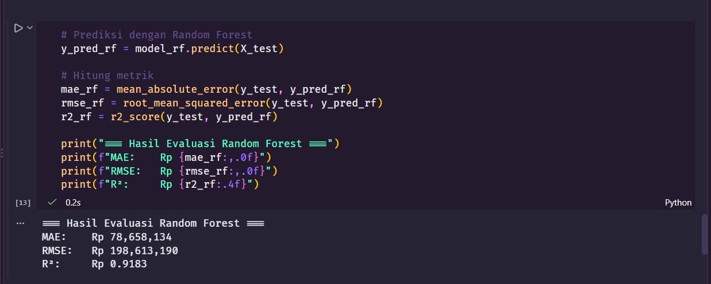
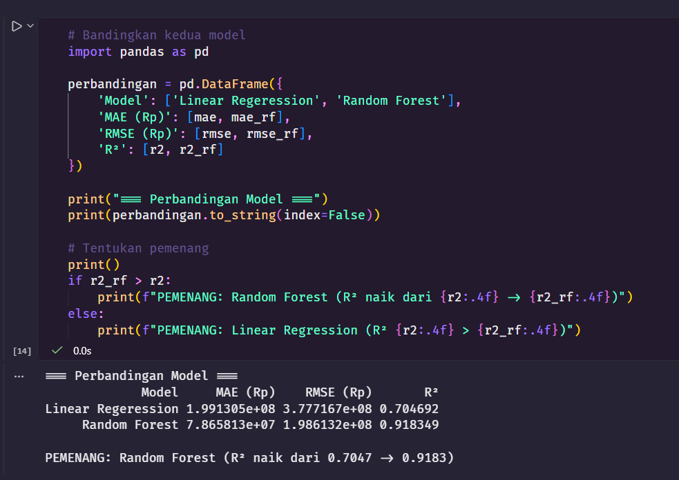
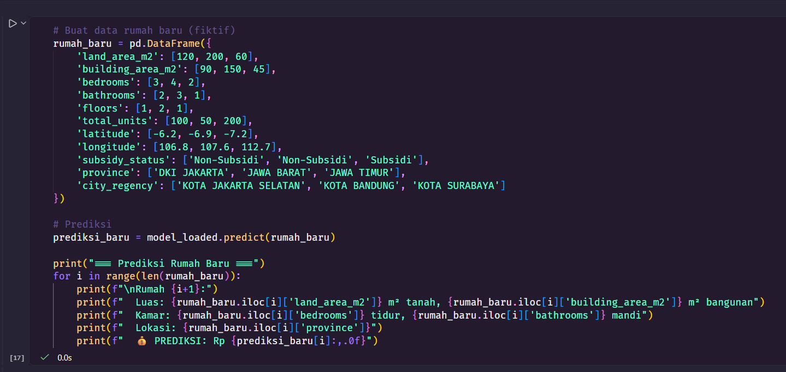
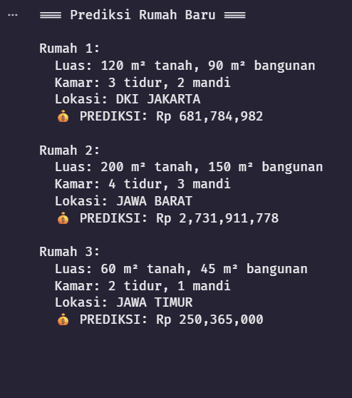

# 🏠 AI Prediksi Harga Rumah Indonesia

Project machine learning untuk memprediksi harga rumah di Indonesia berdasarkan fitur-fitur seperti luas tanah, luas bangunan, jumlah kamar, lokasi, dan lainnya.

## 📊 Dataset

- **Sumber:** [Indonesia Affordable Housing - Kaggle](https://www.kaggle.com/datasets/zororaka/indonesia-affordable-housing)
- **Jumlah data:** 87.143 baris × 22 kolom
- **Setelah preprocessing:** 87.068 baris × 11 fitur

## 🎯 Hasil Model

| Model | MAE | RMSE | R² |
|-------|-----|------|-----|
| Linear Regression | Rp 199.130.551 | Rp 377.716.712 | 0.7047 |
| **Random Forest** | **Rp 78.658.134** | **Rp 198.613.190** | **0.9183** |

**Model terbaik:** Random Forest dengan R² = **91,83%**

## 📸 Screenshot

### 1. Evaluasi Model Random Forest


### 2. Perbandingan Linear Regression vs Random Forest


### 3. Prediksi Rumah Baru




## 📁 Struktur Project

```
project-harga-rumah/
├── data/              # Dataset (tidak di-upload ke GitHub)
├── models/            # Model tersimpan (.pkl)
├── notebooks/         # Jupyter Notebooks
│   ├── 01_eda.ipynb           # Eksplorasi data
│   ├── 02_preprocessing.ipynb # Pembersihan data
│   └── 03_modeling.ipynb      # Training & evaluasi model
└── src/               # Script Python (opsional)
```

## 🛠️ Cara Menjalankan

1. Clone repo ini
2. Install library: `pip install -r requirements.txt`
3. Download dataset dari Kaggle (lihat link di atas)
4. Jalankan notebook `01_eda.ipynb` → `02_preprocessing.ipynb` → `03_modeling.ipynb`

## 📈 Alur Pengerjaan

1. **EDA** — Eksplorasi dataset, cek missing values & outlier
2. **Preprocessing** — Buang leakage, outlier, normalisasi
3. **Modeling** — Training Linear Regression & Random Forest
4. **Evaluasi** — Bandingkan performa model
5. **Prediksi** — Simpan model & test dengan rumah baru

## 👤 Author

**arifinilham-javthon**